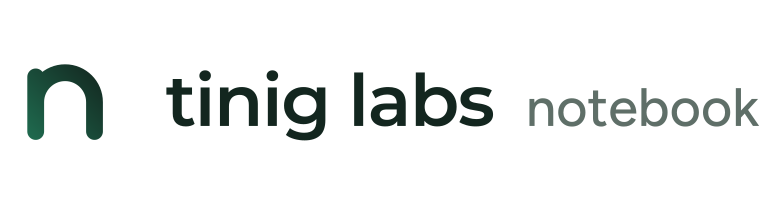

<h1 align="center">
  <a href="https://notebook.tiniglabs.digital">
    <picture>
      <source media="(prefers-color-scheme: dark)" srcset="public/banner-dark.svg">
      
    </picture>
  </a>
</h1>

<p align="center">
  A recording notebook for speech-language pathologists: record, label and transcribe patient speech, on any device, encrypted.
</p>

<p align="center">
  <a href="https://notebook.tiniglabs.digital">Notebook</a>
  &nbsp;&nbsp;|&nbsp;&nbsp;
  <a href="https://tiniglabs.digital">tinig labs</a>
  &nbsp;&nbsp;|&nbsp;&nbsp;
  <a href="https://github.com/tinig-labs">GitHub</a>
</p>

<p align="center">
  <a href="LICENSE.md"></a>
  <a href="modal/LICENSE"></a>
  
  
  
  <a href="https://github.com/tinig-labs/notebook.tiniglabs.digital/actions/workflows/deploy.yml"></a>
</p>

---

This is the source for [notebook.tiniglabs.digital](https://notebook.tiniglabs.digital), a notebook where speech-language pathologists (SLPs) keep their patients' speech recordings. *Tinig* is Filipino for voice.

An SLP records a patient saying a word or sentence from their own target list. A phoneme model drafts the IPA. The notebook lines it up against the ideal IPA sound by sound, marks each error as a substitution, omission, distortion or addition, and suggests the phonological process. The SLP corrects the patient's IPA in place, adds notes, and follows each target's percent consonants correct over time.

It's an installable app for Android, iPhone, iPad and computers. It works offline and syncs between devices. Patient data is encrypted on the device before it's stored or synced, without a passphrase to remember.

The notebook is in closed beta for practising SLPs. Request access on [the home page](https://notebook.tiniglabs.digital/#request). The open speech corpus is a separate repository, [collect.tiniglabs.digital](https://github.com/tinig-labs/collect.tiniglabs.digital).

## What's in the app

| Page | What it does |
|---|---|
| `/` | Explains the notebook and takes beta access requests |
| `/sign-in` | Passwordless sign-in with a 6-digit email code, for approved emails only |
| `/app` | Patients, with search, sorting, recordings to review and the latest PCC |
| `/app/patient` | One patient: consent, progress by target, the recording timeline and a side-by-side compare |
| `/app/record` | The recording station: the target as a flashcard, with its ideal IPA, and a record button |
| `/app/recording` | One recording: playback, the patient's IPA against the target as SODA tiles, scores, notes |
| `/app/library` | Target words and sentences with their ideal IPA (CSV import and export), and labels |
| `/app/settings` | Account, export to ZIP, devices, storage, and account deletion |
| `/admin` | For admins: approve or remove beta access |
| `/privacy`, `/terms` | Privacy notice and Terms of Service, under the Data Privacy Act of 2012 |

The app runs on Cloudflare Workers with Neon Postgres and Neon Auth, and stores encrypted audio in a private Cloudflare R2 bucket. Comparing IPA runs in the browser, using [panphon](https://github.com/dmort27/panphon)'s phonological features. The phoneme model runs on Modal when an SLP asks for a transcription.

## Quick start

```bash
npm install
cp .dev.vars.example .dev.vars    # then fill in the values
npm run dev                       # http://localhost:3000
```

You need Node.js 22 and your own Neon database. For the full setup, including Neon Auth, R2, the model and the Workers runtime, see [DEVELOPMENT.md](DEVELOPMENT.md).

Every push to `main` deploys to production.

## Documentation

- [DEVELOPMENT.md](DEVELOPMENT.md): local setup, first-time infrastructure, conventions and security procedures
- [CONTRIBUTING.md](CONTRIBUTING.md): how to report bugs and security problems, and how to propose changes
- [LICENSING.md](LICENSING.md): which license covers the code, the model code and the data it uses
- [ACKNOWLEDGEMENTS.md](ACKNOWLEDGEMENTS.md): the software, data, model and services the notebook is built on
- [BRAND.md](BRAND.md): the tinig labs logo family, colours and type, and how the notebook uses them

## License

The web app is under the [Functional Source License 1.1, Apache 2.0 Future License](LICENSE.md) (FSL-1.1-ALv2). You can use, copy and change it for anything except a competing commercial product. Each version becomes available under Apache 2.0 two years after it's published.

The model service in `modal/` is under the [GNU Affero General Public License v3.0](modal/LICENSE). The panphon feature table and the epitran Tagalog rules are MIT-licensed. The phoneme model weights are their authors' work under CC BY-NC-SA 4.0; they aren't part of this repository and aren't covered by its licenses. Patients' recordings and notes belong to the SLPs and patients, never to this repository. [LICENSING.md](LICENSING.md) has the details.

The tinig labs name and logo aren't covered by these licenses.
